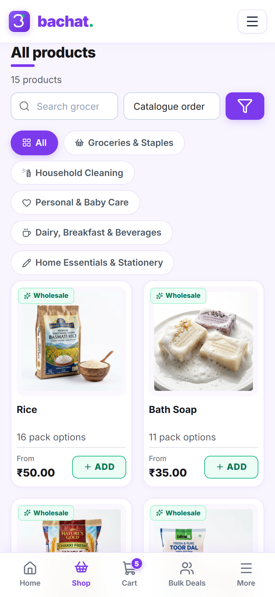
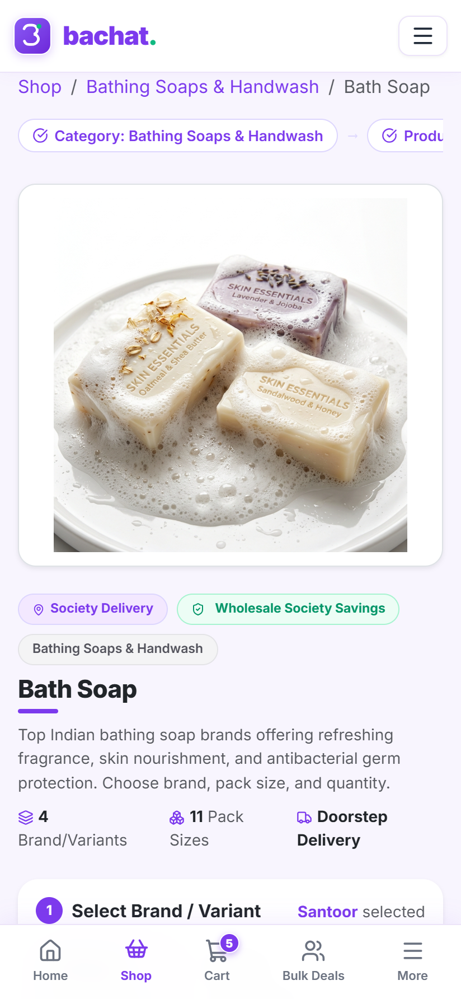
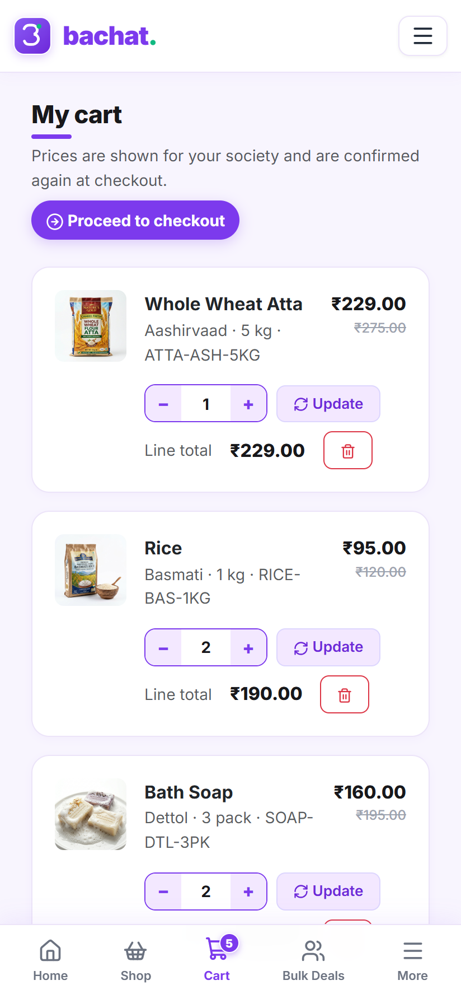
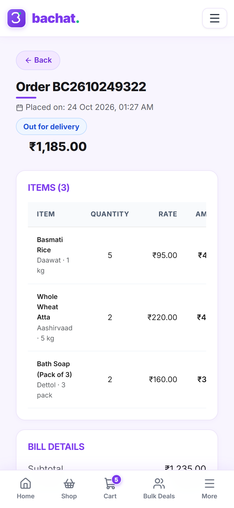
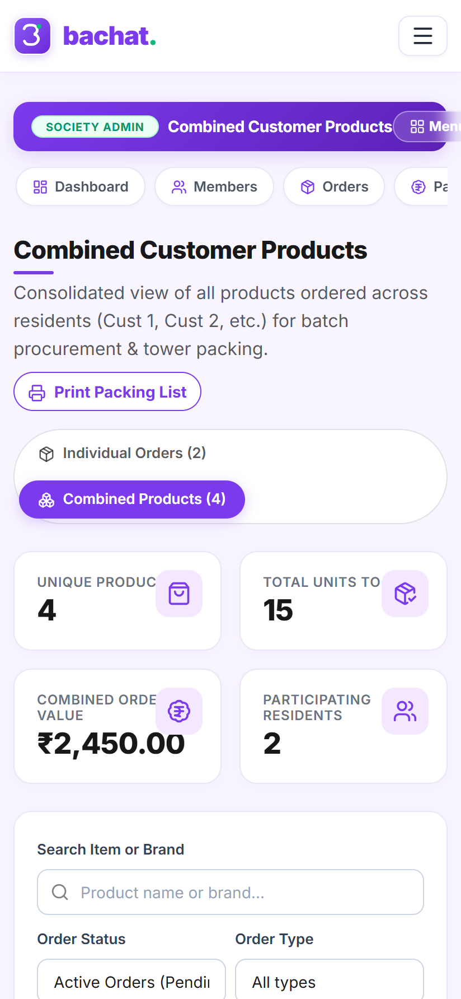
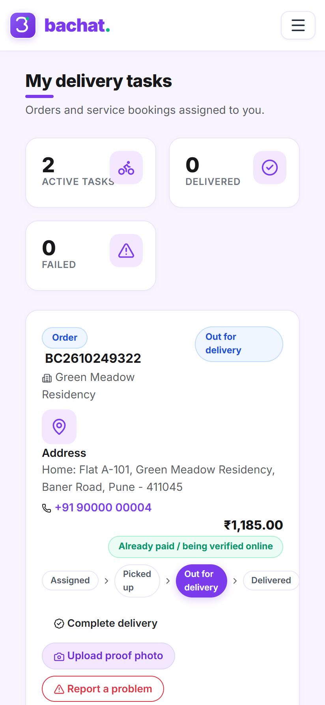
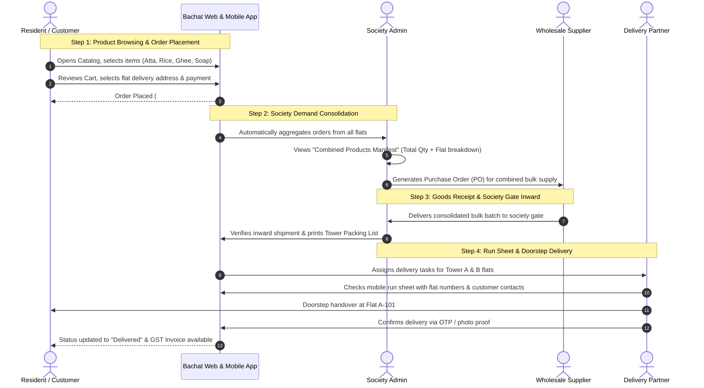
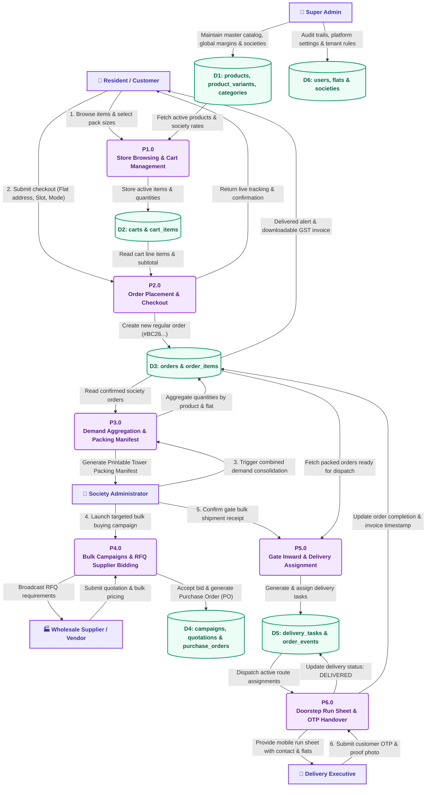

# Bachat (बचत) — Har Society Ki Smart Bachat

<p align="center">
  
  <br>
  <b>Hyperlocal Community Bulk-Buying, Grocery Delivery & Society Operations SaaS</b>
  <br>
  <i>Built with Pure PHP 8.1+, MySQL/MariaDB & Modern Blinkit Purple Design Aesthetics — Zero Composer or Node.js Dependencies Required.</i>
</p>

<p align="center">
  
  
  
  
  
</p>

---

## 🌟 Overview

**Bachat (बचत)** is a full-fledged, multi-society community commerce platform designed for gated residential societies, apartment complexes, and residential welfare associations (RWAs). 

Instead of residents ordering groceries and essentials individually at retail prices, Bachat pools the buying power of the entire society to unlock wholesale cooperative rates, batch deliveries right to tower doorsteps, and simplify society facility management.

---

## 📸 Application Screenshots

<div align="center">

### 📱 Mobile-First Experience: End-to-End Order to Delivery Workflow

| 🛒 **1. Grocery Store Catalog** | 🔍 **2. Pack Size & Savings** | 🛍️ **3. Cart & Doorstep Slot** |
| :---: | :---: | :---: |
|  |  |  |
| *Real products, categories & wholesale rates* | *Multi-pack options & variant selector* | *Cart review & free society batch delivery* |

<br>

| 📦 **4. Real-time Order Tracking** | 🧩 **5. Society Combined Manifest** | 🚴 **6. Delivery Partner Portal** |
| :---: | :---: | :---: |
|  |  |  |
| *Status tracking, bill breakdown & timeline* | *Consolidated orders across all flats* | *Run sheet, flat numbers & proof handover* |

</div>

---

## 🔄 End-to-End Process Workflow: Order Se Delivery Tak (Complete Guide)

Bachat platform ka main motive housing societies ke residents ko direct wholesale prices provide karna aur operational delivery ko smooth banana hai. Yeh poora process kaise kaam karta hai:



### 📋 Phase-by-Phase Detailed Explanation:

#### 1️⃣ Phase 1: Customer Order Placement (रेजिडेंट द्वारा आर्डर देना)
- **Role**: `customer@bachat.com` (Resident - Flat A-101).
- **Process**:
  1. Resident mobile app open karta hai aur Blinkit-style store par grocery items (Atta, Rice, Dal, Soap, Cow Ghee) browse karta hai.
  2. Product card par click karke pack size select karta hai (e.g., Basmati Rice 1kg, Aashirvaad Atta 5kg, Dettol Soap 3pk).
  3. Items cart me add hoti hain. Cart review screen par subtotal, society bulk savings, aur delivery slot (Flat A-101) select karke **"Proceed to Checkout"** press karta hai.
  4. Payment method me UPI QR / Netbanking ya Cash on Delivery select karke order place hota hai.

#### 2️⃣ Phase 2: Instant Order Confirmation & Live Tracking (आर्डर कन्फर्मेशन व ट्रैकिंग)
- **Role**: Customer (`customer@bachat.com`).
- **Process**:
  1. System unique order number generate karta hai (e.g. `BC2610249322`).
  2. Customer ko live progress tracker dikhta hai: `Order Confirmed` &rarr; `Society Bulk Packing` &rarr; `Out for Delivery` &rarr; `Delivered`.
  3. Order ki complete item list, unit rates, delivery charges (`₹0.00` batch delivery), aur total bill details customer dashboard me transparently visible rehti hain.

#### 3️⃣ Phase 3: Society Admin Consolidated Demand & Packing Manifest (सोसायटी बल्क कम्बाईन)
- **Role**: `society@bachat.com` (Society Admin - Green Meadow Residency).
- **Process**:
  1. Jab society ke multiple residents (Cust 1, Cust 2, etc.) orders place karte hain, Society Admin portal par **"Combined Customer Products"** view automatically open hota hai.
  2. System saare orders ko product-wise consolidate kar deta hai:
     - **Basmati Rice (1kg)**: Total 9 kg required (Flat A-101: 5 kg | Flat B-204: 4 kg).
     - **Whole Wheat Atta (5kg)**: Total 3 bags required (Flat A-101: 2 bags | Flat B-204: 1 bag).
     - **Pure Desi Cow Ghee (1L)**: Total 1 can required (Flat B-204: 1 can).
     - **Bath Soap (3pk)**: Total 2 packs required (Flat A-101: 2 packs).
  3. **Print Packing List Button**: Society manager 1-click me printable packing manifest nikal sakta hai jisse tower aur flat ke hisab se packing bag ready ho sake.

#### 4️⃣ Phase 4: Wholesale Inward & Tower Batching (होलसेल सप्लाई व इनवर्ड)
- **Role**: Vendor (`vendor@bachat.com`) + Society Admin.
- **Process**:
  1. Wholesale vendor pura stock single bulk batch me society security gate/clubhouse par deliver karta hai.
  2. Society admin quantity verify karke goods receipt accept karta hai.
  3. Packing manifest ke anusaar items ko flat-wise packets (Flat A-101 packet, Flat B-204 packet) me pack kiya jata hai.

#### 5️⃣ Phase 5: Delivery Partner Assignment & Mobile Run Sheet (डिलीवरी रन शीट)
- **Role**: `delivery@bachat.com` (Delivery Executive - Vijay Kale).
- **Process**:
  1. Delivery partner apne mobile me login karta hai aur **"My Delivery Tasks"** dashboard open karta hai.
  2. Usko assigned flats ki direct list dikhti hai:
     - **Order #BC2610249322**: Flat A-101 (Priya Sharma, +91 90000 00004).
     - **Order #BC2610249400**: Flat B-204 (Rahul Patil, +91 90000 00005).
  3. One-tap call button se delivery boy resident se directly contact kar sakta hai.

#### 6️⃣ Phase 6: Doorstep Handover & Delivery Completion (डोरस्टेप डिलीवरी व रिसिप्ट)
- **Role**: Delivery Partner + Customer.
- **Process**:
  1. Delivery boy resident ke doorstep par packet handover karta hai.
  2. OTP verification ya proof photo upload karke **"Mark Delivered"** karta hai.
  3. Customer ke app me order status instantly **"Delivered"** update ho jata hai aur official GST Tax Invoice download ke liye available ho jata hai.

---

## 🔀 System Data Flow Diagram (DFD Level-1)

Yeh Data Flow Diagram (DFD) yeh illustrate karta hai ki platform me users (Residents, Society Admins, Wholesale Vendors, Delivery Agents) ke beech data kis tarah alag-alag processes aur MySQL database tables ke madhyam se flow hota hai:



### 📊 Data Flow Breakdown:

| Process ID | Process Name | Inputs | Data Store Affected | Output / Recipient |
| :--- | :--- | :--- | :--- | :--- |
| **P1.0** | Store Browsing & Cart | Category filter, search query, pack choice | `D1 (products)`, `D2 (carts)` | Active cart items, instant discount display |
| **P2.0** | Order Checkout | Delivery slot, flat address, payment type | `D2 (carts)`, `D3 (orders)` | Order `#BC26...`, live tracking timeline |
| **P3.0** | Demand Aggregation | Multiple resident orders across flats | `D3 (orders, order_items)` | Combined bulk packing manifest for society admin |
| **P4.0** | Bulk Campaigns & RFQ | Campaign target, vendor bids, quotation rates | `D4 (campaigns, quotations, PO)` | Finalized wholesale contract & PO generation |
| **P5.0** | Gate Inward & Assignment | Physical shipment receipt, delivery staff ID | `D3 (orders)`, `D5 (delivery_tasks)` | Flat-wise task queue assigned to delivery agent |
| **P6.0** | Doorstep OTP Handover | Delivery OTP, proof photo, cash collection | `D5 (tasks)`, `D3 (orders)` | Order marked `DELIVERED`, printable GST invoice |

---

## ⚡ Core Features

### 🛒 1. Hyperlocal Grocery Store (Blinkit-Style UI)
- **Modern Blinkit Purple & Mint Design**: Fast, vibrant shopping interface tailored for quick navigation.
- **Hierarchical Catalog**: Main Categories &rarr; Subcategories &rarr; Master Products &rarr; Brand & Pack Variants (1kg, 5kg, 10kg, 500ml, 5L).
- **Multi-lingual Support**: Full support for English, हिन्दी (Hindi), and मराठी (Marathi).
- **Cart & Express Checkout**: Smart quantity counters, instant savings badges, and doorstep tower delivery selection.

### 📦 2. Community Bulk Campaigns
- **Wholesale Group Buying**: Society admins launch time-bound buying campaigns for staples (e.g. Atta 30kg, A2 Cow Ghee 5L, Mustard Oil 15L).
- **Target Aggregation**: Visual live progress bars showing society order targets.
- **RFQ & Vendor Bidding**: Open quotations from verified local wholesale suppliers with transparent pricing.
- **PO & Goods Receipt**: Complete purchase order workflow and inventory check upon gate delivery.

### 🧩 3. Combined Customer Products Manifest (Consolidated Demand)
- **Automated Order Aggregation**: Automatically combines items across all residents (Cust 1, Cust 2, etc.) into one master procurement list.
- **Per-Product Customer Breakdown**: Society admins and gate delivery staff see exactly who ordered how much (Customer Name, Flat Number, Ordered Qty, Order #).
- **Printable Manifest**: 1-click printer-friendly packing list for tower sorting and gate distribution.

### 🛠️ 4. Society Home Services & Maintenance
- **Trusted Local Services**: Plumbing, electrical, AC servicing, deep cleaning, and pest control.
- **Group Service Deals**: Discounted society-wide booking drives when multiple flats book the same service window.

### 🏢 5. Multi-Society Administration & Governance
- **Resident Directory & Flats**: Tower/Block and flat management with owner/tenant verification.
- **Notice Board**: Digital society notices with sticky pins, expiry dates, and read receipts.
- **Support Desk & Helpdesk**: In-app ticketing system with SLA timers, categories, and audit trails.
- **Payment Verification**: Manual UPI QR / UTR verification with admin double-check (unverified orders are never marked paid).

---

## 👥 Default Demo Credentials

For testing and demonstration, pre-seeded accounts are configured with the universal password `123456`:

| Role | Email | Password | Scope / Society |
| :--- | :--- | :--- | :--- |
| **Super Admin** | `admin@bachat.com` | `123456` | Platform Owner (All Societies, Global Catalog, Vendors) |
| **Society Admin 1** | `society@bachat.com` | `123456` | Green Meadow Residency (Pune) |
| **Society Admin 2** | `society2@bachat.com` | `123456` | Sunrise Heights (Nashik) |
| **Resident 1 (Cust 1)** | `customer@bachat.com` | `123456` | Flat A-101 (Green Meadow Residency) |
| **Resident 2 (Cust 2)** | `customer2@bachat.com` | `123456` | Flat C-501 (Sunrise Heights) |
| **Vendor 1** | `vendor@bachat.com` | `123456` | FreshFarms Wholesale (Grocery Supplier) |
| **Vendor 2** | `vendor2@bachat.com` | `123456` | SwiftServe Facilities (Service Contractor) |
| **Delivery Staff 1** | `delivery@bachat.com` | `123456` | Green Meadow Residency Delivery Fleet |
| **Delivery Staff 2** | `delivery2@bachat.com` | `123456` | Sunrise Heights Delivery Fleet |

*(Full credential details documented in [`CREDENTIALS.md`](CREDENTIALS.md))*

---

## 🚀 Quick Setup & Installation

### Prerequisites
- **PHP**: `8.1` or higher (`pdo_mysql`, `fileinfo`, `mbstring`, `gd` enabled)
- **Database**: MySQL `5.7+` or MariaDB `10.3+`
- **Web Server**: Apache with `mod_rewrite` enabled (works seamlessly on XAMPP, WAMP, LAMP, cPanel, or InfinityFree)

### 1. Clone the Repository
```bash
git clone https://github.com/your-username/Bachat-php.git
# Or extract into your Apache web root: e.g. C:/xampp/htdocs/Bachat-php
```

### 2. Import Database
1. Open **phpMyAdmin** (`http://localhost/phpmyadmin`) or MySQL CLI.
2. Create a new database named `bachat` (Character set: `utf8mb4_general_ci`).
3. Import the provided schema file:
```bash
mysql -u root -p bachat < database.sql
```

### 3. Environment Configuration
Copy the sample config file to create your local configuration:
```bash
# In app/config/
cp app/config/config.example.php app/config/config.php
```
Open `app/config/config.php` and set your database connection parameters:
```php
'db' => [
    'host'    => 'localhost',
    'name'    => 'bachat',
    'user'    => 'root',
    'pass'    => '',
    'charset' => 'utf8mb4',
],
```

### 4. Run the Application
Start Apache and MySQL from your control panel, then navigate to:
```
http://localhost/Bachat-php
```

---

## 📁 Repository Structure

```
Bachat-php/
├── app/
│   ├── config/              # Configuration (config.example.php tracked)
│   ├── controllers/         # MVC Controllers (Admin, Shop, Orders, Super Admin)
│   ├── core/                # Core Framework (Router, Database PDO, RateLimiter, Auth)
│   ├── helpers/             # Global Helper Functions (formatting, auth, money, i18n)
│   ├── lang/                # Localization (English, Hindi, Marathi)
│   ├── models/              # Data Access & Entity Models
│   ├── services/            # Business Services (Cart, Order processing, Notifications)
│   ├── views/               # PHP Views & Blinkit Layouts (Admin, Super, Resident, Vendor)
│   └── routes.php           # Central Declarative Route Definitions
├── assets/
│   ├── css/
│   │   └── app.css          # Curated Blinkit Purple Design System & Print Styles
│   ├── js/
│   │   └── app.js           # Interactive UI (Cart, Modals, Quantity Steppers)
│   └── img/                 # Logos, Brand Assets, Icons
├── uploads/                 # Media directory with .htaccess script execution protection
├── cron.php                 # Automated lifecycle runner (Campaigns, Subscriptions, SLA)
├── database.sql             # Complete Schema & Pre-seeded Sample Data
├── CREDENTIALS.md           # Secure Demo Logins Directory
├── .gitignore               # Strict security & environment ignore rules
├── .gitattributes          # Cross-platform LF line ending normalization
├── LICENSE                  # MIT License
└── index.php                # Front Controller Entry Point
```

---

## 🔒 Security Architecture

- **Prepared Statements**: 100% of queries use PDO parameter binding; SQL injection is structurally prevented.
- **CSRF Defense**: Automatic cryptographic CSRF tokens on all POST requests.
- **Cross-Site Scripting (XSS)**: All view data strictly escaped via `e()` helper.
- **Upload Hardening**: Upload files are MIME-sniffed via PHP `finfo` with randomized hashes; script execution (`.php`) is strictly denied in `/uploads/.htaccess`.
- **Tenant Isolation**: Multi-society records strictly verified by user session society scope in both router middleware and controller guards.
- **Session Hardening**: `HttpOnly`, `SameSite=Lax`, regeneration on privilege changes.

---

## 📄 License

This project is licensed under the [MIT License](LICENSE) — free for personal, community, and commercial use.
