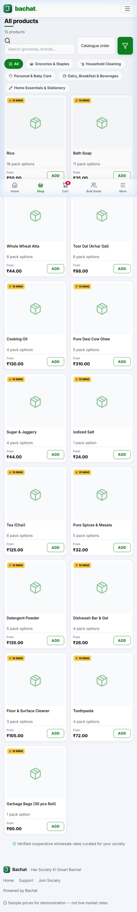
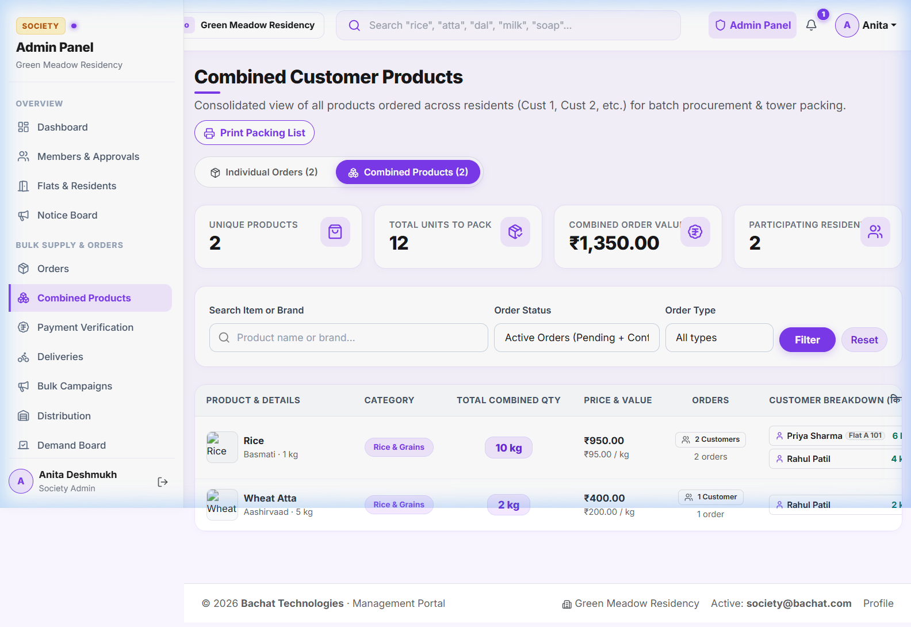
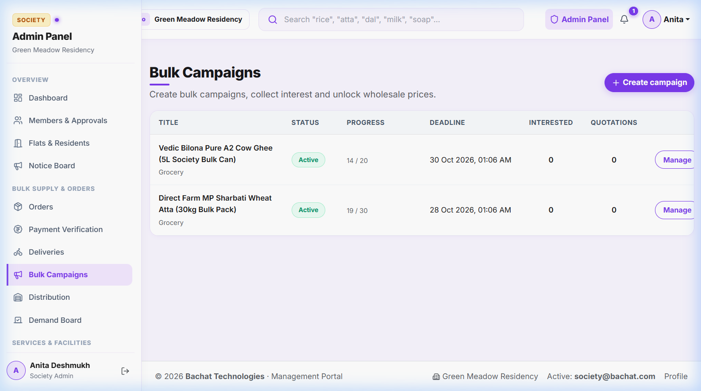
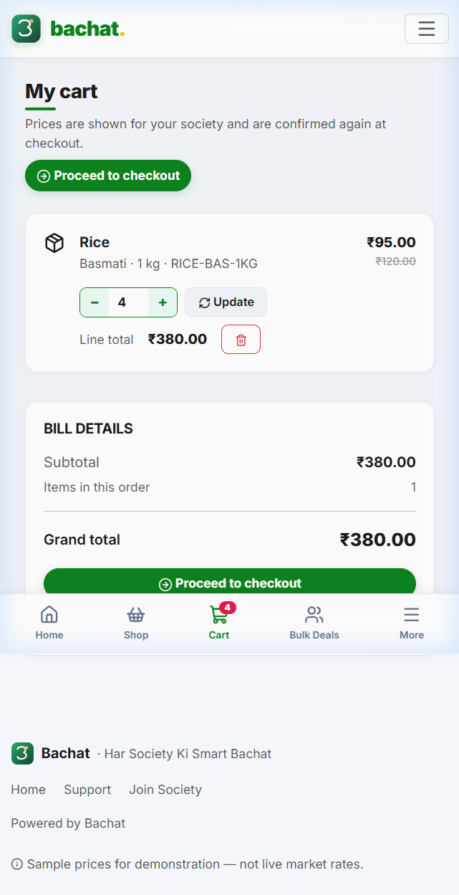
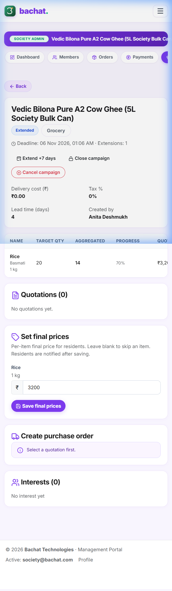

# Bachat (बचत) — Har Society Ki Smart Bachat

<p align="center">
  
  <br>
  <b>Hyperlocal Community Bulk-Buying, Grocery Delivery & Society Operations SaaS</b>
  <br>
  <i>Built with Pure PHP 8.1+, MySQL/MariaDB & Modern Blinkit Purple Design Aesthetics — Zero Composer or Node.js Dependencies Required.</i>
</p>

<p align="center">
  
  
  
  
  
</p>

---

## 🌟 Overview

**Bachat (बचत)** is a full-fledged, multi-society community commerce platform designed for gated residential societies, apartment complexes, and residential welfare associations (RWAs). 

Instead of residents ordering groceries and essentials individually at retail prices, Bachat pools the buying power of the entire society to unlock wholesale cooperative rates, batch deliveries right to tower doorsteps, and simplify society facility management.

---

## 📸 Application Screenshots

<p align="center">
  <b>🛒 Hyperlocal Grocery Store (Blinkit Purple UI)</b><br>
  
</p>

<p align="center">
  <b>🧩 Combined Customer Products Manifest (Consolidated Demand across all Flats)</b><br>
  
</p>

<p align="center">
  <b>📢 Bulk Campaigns & Society Administration Dashboard</b><br>
  
</p>

<table align="center" width="90%">
  <tr>
    <td align="center" width="50%">
      <b>🛍️ Express Cart & Checkout</b><br>
      
    </td>
    <td align="center" width="50%">
      <b>📊 Campaign Lifecycle & RFQ Management</b><br>
      
    </td>
  </tr>
</table>

---

## ⚡ Core Features

### 🛒 1. Hyperlocal Grocery Store (Blinkit-Style UI)
- **Modern Blinkit Purple & Mint Design**: Fast, vibrant shopping interface tailored for quick navigation.
- **Hierarchical Catalog**: Main Categories &rarr; Subcategories &rarr; Master Products &rarr; Brand & Pack Variants (1kg, 5kg, 10kg, 500ml, 5L).
- **Multi-lingual Support**: Full support for English, हिन्दी (Hindi), and मराठी (Marathi).
- **Cart & Express Checkout**: Smart quantity counters, instant savings badges, and doorstep tower delivery selection.

### 📦 2. Community Bulk Campaigns
- **Wholesale Group Buying**: Society admins launch time-bound buying campaigns for staples (e.g. Atta 30kg, A2 Cow Ghee 5L, Mustard Oil 15L).
- **Target Aggregation**: Visual live progress bars showing society order targets.
- **RFQ & Vendor Bidding**: Open quotations from verified local wholesale suppliers with transparent pricing.
- **PO & Goods Receipt**: Complete purchase order workflow and inventory check upon gate delivery.

### 🧩 3. Combined Customer Products Manifest (Consolidated Demand)
- **Automated Order Aggregation**: Automatically combines items across all residents (Cust 1, Cust 2, etc.) into one master procurement list.
- **Per-Product Customer Breakdown**: Society admins and gate delivery staff see exactly who ordered how much (Customer Name, Flat Number, Ordered Qty, Order #).
- **Printable Manifest**: 1-click printer-friendly packing list for tower sorting and gate distribution.

### 🛠️ 4. Society Home Services & Maintenance
- **Trusted Local Services**: Plumbing, electrical, AC servicing, deep cleaning, and pest control.
- **Group Service Deals**: Discounted society-wide booking drives when multiple flats book the same service window.

### 🏢 5. Multi-Society Administration & Governance
- **Resident Directory & Flats**: Tower/Block and flat management with owner/tenant verification.
- **Notice Board**: Digital society notices with sticky pins, expiry dates, and read receipts.
- **Support Desk & Helpdesk**: In-app ticketing system with SLA timers, categories, and audit trails.
- **Payment Verification**: Manual UPI QR / UTR verification with admin double-check (unverified orders are never marked paid).

---

## 👥 Default Demo Credentials

For testing and demonstration, pre-seeded accounts are configured with the universal password `123456`:

| Role | Email | Password | Scope / Society |
| :--- | :--- | :--- | :--- |
| **Super Admin** | `admin@bachat.com` | `123456` | Platform Owner (All Societies, Global Catalog, Vendors) |
| **Society Admin 1** | `society@bachat.com` | `123456` | Green Meadow Residency (Pune) |
| **Society Admin 2** | `society2@bachat.com` | `123456` | Sunrise Heights (Nashik) |
| **Resident 1 (Cust 1)** | `customer@bachat.com` | `123456` | Flat A-101 (Green Meadow Residency) |
| **Resident 2 (Cust 2)** | `customer2@bachat.com` | `123456` | Flat C-501 (Sunrise Heights) |
| **Vendor 1** | `vendor@bachat.com` | `123456` | FreshFarms Wholesale (Grocery Supplier) |
| **Vendor 2** | `vendor2@bachat.com` | `123456` | SwiftServe Facilities (Service Contractor) |
| **Delivery Staff 1** | `delivery@bachat.com` | `123456` | Green Meadow Residency Delivery Fleet |
| **Delivery Staff 2** | `delivery2@bachat.com` | `123456` | Sunrise Heights Delivery Fleet |

*(Full credential details documented in [`CREDENTIALS.md`](CREDENTIALS.md))*

---

## 🚀 Quick Setup & Installation

### Prerequisites
- **PHP**: `8.1` or higher (`pdo_mysql`, `fileinfo`, `mbstring`, `gd` enabled)
- **Database**: MySQL `5.7+` or MariaDB `10.3+`
- **Web Server**: Apache with `mod_rewrite` enabled (works seamlessly on XAMPP, WAMP, LAMP, cPanel, or InfinityFree)

### 1. Clone the Repository
```bash
git clone https://github.com/your-username/Bachat-php.git
# Or extract into your Apache web root: e.g. C:/xampp/htdocs/Bachat-php
```

### 2. Import Database
1. Open **phpMyAdmin** (`http://localhost/phpmyadmin`) or MySQL CLI.
2. Create a new database named `bachat` (Character set: `utf8mb4_general_ci`).
3. Import the provided schema file:
```bash
mysql -u root -p bachat < database.sql
```

### 3. Environment Configuration
Copy the sample config file to create your local configuration:
```bash
# In app/config/
cp app/config/config.example.php app/config/config.php
```
Open `app/config/config.php` and set your database connection parameters:
```php
'db' => [
    'host'    => 'localhost',
    'name'    => 'bachat',
    'user'    => 'root',
    'pass'    => '',
    'charset' => 'utf8mb4',
],
```

### 4. Run the Application
Start Apache and MySQL from your control panel, then navigate to:
```
http://localhost/Bachat-php
```

---

## 📁 Repository Structure

```
Bachat-php/
├── app/
│   ├── config/              # Configuration (config.example.php tracked)
│   ├── controllers/         # MVC Controllers (Admin, Shop, Orders, Super Admin)
│   ├── core/                # Core Framework (Router, Database PDO, RateLimiter, Auth)
│   ├── helpers/             # Global Helper Functions (formatting, auth, money, i18n)
│   ├── lang/                # Localization (English, Hindi, Marathi)
│   ├── models/              # Data Access & Entity Models
│   ├── services/            # Business Services (Cart, Order processing, Notifications)
│   ├── views/               # PHP Views & Blinkit Layouts (Admin, Super, Resident, Vendor)
│   └── routes.php           # Central Declarative Route Definitions
├── assets/
│   ├── css/
│   │   └── app.css          # Curated Blinkit Purple Design System & Print Styles
│   ├── js/
│   │   └── app.js           # Interactive UI (Cart, Modals, Quantity Steppers)
│   └── img/                 # Logos, Brand Assets, Icons
├── uploads/                 # Media directory with .htaccess script execution protection
├── cron.php                 # Automated lifecycle runner (Campaigns, Subscriptions, SLA)
├── database.sql             # Complete Schema & Pre-seeded Sample Data
├── CREDENTIALS.md           # Secure Demo Logins Directory
├── .gitignore               # Strict security & environment ignore rules
├── .gitattributes          # Cross-platform LF line ending normalization
├── LICENSE                  # MIT License
└── index.php                # Front Controller Entry Point
```

---

## 🔒 Security Architecture

- **Prepared Statements**: 100% of queries use PDO parameter binding; SQL injection is structurally prevented.
- **CSRF Defense**: Automatic cryptographic CSRF tokens on all POST requests.
- **Cross-Site Scripting (XSS)**: All view data strictly escaped via `e()` helper.
- **Upload Hardening**: Upload files are MIME-sniffed via PHP `finfo` with randomized hashes; script execution (`.php`) is strictly denied in `/uploads/.htaccess`.
- **Tenant Isolation**: Multi-society records strictly verified by user session society scope in both router middleware and controller guards.
- **Session Hardening**: `HttpOnly`, `SameSite=Lax`, regeneration on privilege changes.

---

## 📄 License

This project is licensed under the [MIT License](LICENSE) — free for personal, community, and commercial use.
